# Hi there, I'm Zakaria Zoulati 👋

#### Software Engineer @ [Ostorlab](https://ostorlab.co)

  

---

## About Me

<table>
<tr>
<td width="60%">

- Software Engineer at **Ostorlab**
- Strong passion for **mathematics**, **algorithms**, and **competitive programming**
- Actively practice **problem solving and competitive programming**
- Focus on **advanced data structures**, **algorithmic thinking**, and writing efficient, reliable code
- Currently diving into **cybersecurity**, exploring how systems work internally, how vulnerabilities emerge, and how to design more secure software
- Love **building real-world projects from scratch** to grow technically and think deeper about system design
- Diving into **open source projects**, reading real-world codebases to learn how they're built and looking for ways to contribute
- Naturally curious, disciplined, and driven by continuous improvement
- Learning every day and pushing limits step by step

</td>
<td width="40%">

</td>
</tr>
</table>

 

 

---

## 🛠 Tech Stack

### Languages

---

### Frameworks & Tools

---

### Databases

  

---

## ⚙️ GitHub Analytics

  
  

---

